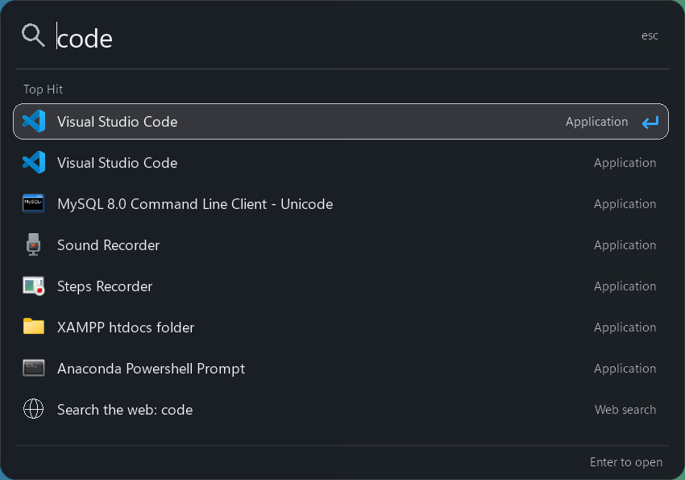

# SpotLight-Search-for-Windows-11

A native Windows 11 launcher for opening applications, finding indexed files, and searching the web from a compact keyboard-driven panel. Built with **C++20 and Win32**, with bounded background work and measured resource use.



*Actual Windows 11 build. The background is translucent; text and icons remain opaque.*

## Features

- **Application search:** ranked matches from Start Menu shortcuts and Windows Store apps.
- **File search:** indexed filename word prefixes through Windows Search, starting at two characters. Absolute drive and UNC paths can also be opened directly.
- **Explicit web search:** a final result opens Bing in your default browser. Typing does not send web queries.
- **Native interface:** real Windows icons, monochrome selection, rounded corners, and a background with approximately 5% transparency.
- **Tray controls:** application refresh, shortcut selection, optional start at sign-in, and Quit.

## Build and run

Requirements:

- Windows 11 on an Intel/AMD x64 machine.
- Visual Studio 2022 or Build Tools with the **Desktop development with C++** workload, Windows SDK, and CMake/Ninja tools.

Clone or download the repository, then run these commands from its root in PowerShell:

```powershell
powershell -NoProfile -ExecutionPolicy Bypass -File scripts/build.ps1
.\build\release\Spotlight.exe
```

The script discovers Visual Studio, builds Release, and runs core tests. Append `-Configuration debug` for Debug.

To produce a single portable executable:

```powershell
powershell -NoProfile -ExecutionPolicy Bypass -File scripts/package.ps1
```

The output is `dist/Spotlight.exe`, with the C++ runtime included. Copy it to another Windows 11 x64 machine to run it without developer tools. Generated binaries are excluded from Git.

## Controls

| Shortcut or action | Behavior |
| --- | --- |
| Windows+Space | Show or hide the panel |
| Up / Down | Select a result |
| Enter | Open the selected result |
| Escape or click outside | Dismiss the panel |
| Right-click the tray icon | Open settings and application controls |

While the app runs, Windows+Space replaces Windows' keyboard-language switching shortcut. Choosing Ctrl+Alt+Space in the tray menu, or quitting the app, restores that Windows shortcut. If the Windows+Space hook cannot start, the app tries Ctrl+Alt+Space.

Keep the executable in a permanent folder before enabling **Start at sign-in**. Closing the panel leaves the app in the tray; use **Quit** to stop it.

## Performance

A documented Release run on a Ryzen 5 5500U laptop with approximately 8 GB RAM recorded:

| Measurement | Observation |
| --- | ---: |
| Portable executable | 363 KiB |
| Private memory after the interaction/idle check | 11.6 MiB |
| Resident working set after that check | 46.6 MiB |
| Complete show/type/hide cycle, p95 | 63.6 ms |
| CPU time increase during a 30-second hidden-idle sample | 0 at measurement resolution |

These observations are workload-specific. The cycle includes showing, typing, and hiding; it is not first-paint latency. Per-pixel rendering increased cycle cost compared with the earlier UI. Later opacity-only changes were checked visually but not rebenchmarked. Windows Search, DWM, and browser costs are separate.

See the [benchmark report and raw results](docs/benchmark-results.md) for hardware, workloads, earlier comparisons, and measurement limits.

## How it works

- A message-driven UI keeps native input and result controls for keyboard and accessibility state. A reusable BGRA surface composites the background and foreground separately.
- File search uses one active query and one replaceable pending query. Generation IDs reject stale results; queries retrieve at most 100 filenames for the eight-row panel.
- Shell icons load on a background worker and use a 32-entry LRU cache. No Shell icon extraction runs in the paint path.
- Keyboard and mouse hooks use dedicated message threads. The outside-click hook is removed while hidden, and caret/entrance timers stop when the panel closes.

| Source | Responsibility |
| --- | --- |
| [main.cpp](src/main.cpp), [panel_surface.h](src/panel_surface.h) | UI state, input coordination, rendering |
| [core.cpp](src/core.cpp), [provider.cpp](src/provider.cpp) | App discovery, ranking, URL construction, Windows Search |
| [icons.cpp](src/icons.cpp) | Asynchronous icon loading and cache |
| [storage.cpp](src/storage.cpp), [shortcut.h](src/shortcut.h), [outside_click.h](src/outside_click.h) | Persistence, startup, shortcuts, dismissal |

## Tests

The build runs core tests for ranking, Unicode, query/URL escaping, limits, paths, and stale-query handling.

For UI checks, install Python 3 with Tk support and Pillow, then quit the running launcher:

```powershell
python -m pip install Pillow
python scripts/contrast_test.py
python scripts/dismiss_test.py
python scripts/ui_test.py --idle 30 --launch-test
```

The scripts display test windows and check contrast, dismissal, selection, fixture launching, 1,000 interaction cycles, and idle resources. Python is needed only for development checks.

Additional probes and reproducible measurement notes are in [scripts](scripts/) and the [benchmark report](docs/benchmark-results.md).

## Data and limitations

Settings and launch-frequency history live in `%LOCALAPPDATA%\Spotlight`. History is capped at 500 targets; delete `history.txt` while closed to reset it. Web searches are excluded, though your browser can retain them. An immediate exit can lose the latest history update.

- File coverage and freshness depend on Windows indexing. Application search still works if the Search service is unavailable.
- The panel shows at most eight rows and reserves one for web search when the query permits it.
- Newly installed apps require **Refresh applications**. Different Start Menu sources can produce duplicate names.
- Narrator, IME composition, high contrast, multiple DPI/monitor setups, sleep/resume, and battery use need broader manual validation.

## Contributing

Bug reports and focused pull requests are welcome. For a bug, include the Windows version, steps to reproduce, expected behavior, and actual behavior. A screenshot helps with visual issues.

For a pull request, explain the change and run the Release build plus relevant checks. Performance claims need a reproducible workload, hardware context, and private-memory/working-set measurements. Discuss larger feature proposals in an issue.

## License

[MIT](LICENSE). Copyright (c) 2026 Aryan Kumar.
