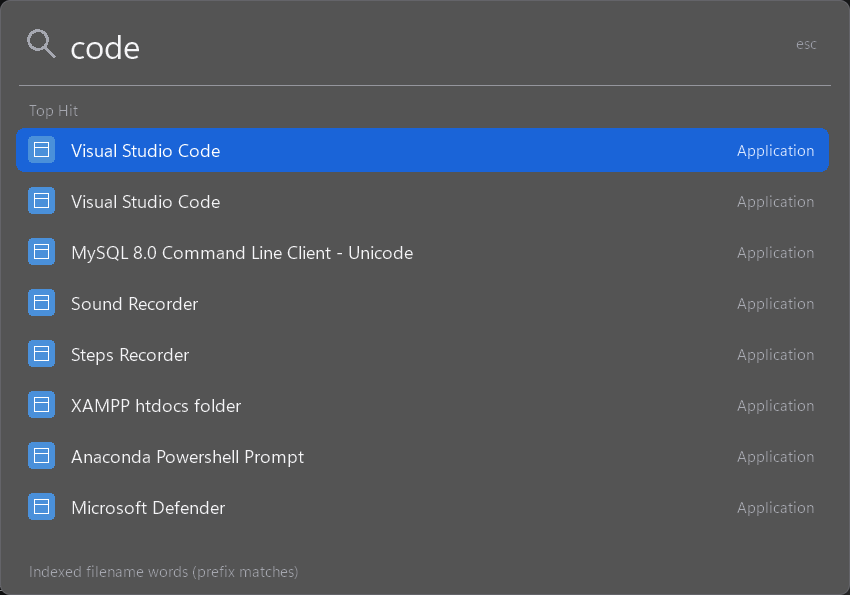

# Local implementation and benchmark results

Latest delivery: see **Minimal monochrome focus** at the end of this report. Earlier sections preserve measurements for previous builds.

Measured October 24-25, 2026 on this laptop: Ryzen 5 5500U, 6 cores / 12 logical processors, approximately 7.36 GiB physical RAM, Windows 11 Home build 26200. Release x64 MSVC build, static CRT, size optimization and link-time optimization. These are local observations, not guarantees on other machines.

## Final UI

Classic compact Spotlight-inspired layout: 680 x 68 DIP empty bar, expanded results, rounded corners, native Desktop Acrylic, composited text, blue keyboard selection, eight visible results and a 120 ms entrance movement. No continuous animation. Windows transparency and animation preferences control the effects; solid fallback is available. Windows fonts/materials approximate the reference; this is not Apple's exact renderer. Generic vector-like application/file glyphs avoid loading icon assets.

## Final executable and interaction check

Executable: **334,336 bytes (326.5 KiB)**. Windows system DLLs remain dependencies; executable size is not RAM usage.

`python scripts/ui_test.py --idle 30 --launch-test` passed. It exercises 1,000 show/type/hide cycles, a second-instance activation, keyboard selection retention, misses, absolute paths and a harmless fixture executable launch. Core CTest suite also passed.

| Measurement | Final build |
|---|---:|
| Private memory after 1,000 cycles | 5.70 MiB |
| Working set after 1,000 cycles | 33.16 MiB |
| Private memory after idle | 5.63 MiB |
| Complete show/type/hide cycle p50 / p95 | 11.24 / 15.77 ms |
| CPU time accumulated in 30-second idle sample | 0 seconds at measurement resolution |
| Disk writes during idle sample | 0 bytes |

Handles stayed at 371 across the interaction loop; GDI objects decreased from 40 to 34 and USER objects remained at 21. The checks found no growing GDI/USER resources or private-memory growth beyond the test threshold. This does not prove all possible paths leak-free. Cycle timing is **not first-paint or end-to-end search latency**. Working set includes resident shared/system code; private bytes measure private committed memory.

An earlier UI version also completed a 600-second idle observation with zero disk writes and approximately 0.00087% average total-machine CPU. That longer observation is saved separately and does not validate the final acrylic rendering over ten minutes.

## C, C++ and Rust comparison

Seven interleaved runs per language with the same fixed 5,000-entry catalogue and native control workload. C++ uses the same C-shaped benchmark source as C. No provider, allocation-count or long-idle measurements are included. This is not a comparison of complete applications or a universal ranking of languages.

| Language | Executable bytes | Median hidden private MiB | Median rank p50 ms |
|---|---:|---:|---:|
| c | 157696 | 2.00 | 0.380 |
| cpp | 157696 | 2.00 | 0.382 |
| rust | 241152 | 1.96 | 0.757 |

Memory was effectively tied. C++ was retained for native COM integration and resource management without a browser, managed runtime or application framework. Rust remains a viable alternative. File Pilot inspired the bounded native architecture; no equivalent-feature comparison against File Pilot was performed.

## Search provider

Real catalogue sample: 196 applications, 1.64 seconds to discover in a background worker; ranking p50 0.0161 ms / p95 0.0245 ms before the final eight-row UI revision.

The final indexed filename suite made 100 calls: 95 real queries and five intentional one-character skips, with zero provider errors. Provider-only p50 29.36 ms, p95 81.20 ms, maximum 106.26 ms. These exclude the 40 ms input debounce, painting and cold-start effects. Switching from SQL LIKE to full-text filename word prefixes removed the observed timeout problem, but changes matching semantics: this is not arbitrary substring matching. Coverage depends on the existing Windows index.

Windows Search runs separately. Its indexer was observed at roughly 41 MiB private memory before testing and around 79 MiB during indexing/test activity; other search hosts also use resources. These shared-service costs and DWM/GPU costs are **not included** in launcher process memory. The new SDK installation also affected indexing, so incremental attribution is unavailable.

## Remaining verification and limits

- Manual Narrator, IME composition, multiple DPI/monitor layouts, high contrast, sleep/resume and battery profiling remain unverified. Native controls preserve the underlying input/accessibility mechanisms, but custom painting still needs these checks.
- Native Start Menu sources can expose duplicate application names. Generic glyphs are used instead of application artwork.
- No independent full-disk index, previews, calculator, online suggestions or plugin system.
- History writes are asynchronous; immediate exit can lose the latest frequency update.
- Raw data in [measurements](measurements/) accompanies these observations. Reproduce with the scripts listed in README.md.

## Windows+Space portable release - October 25, 2026

Final deliverable: `dist/Spotlight.exe`, **336,896 bytes (329 KiB)**. It is portable and directly runnable, not an installer. No administrator access or separate runtime installation is required on the tested Windows 11 x64 system. Build and core tests pass. Both Windows keys, autorepeat suppression and both key-release orders passed synthetic input integration tests. The packaged executable is byte-identical to the tested build.

The added dedicated keyboard-hook thread redirects the reserved Windows+Space language-switching chord while the app runs. It has no polling loop or input logging. Quit restores the Windows shortcut. The existing Start at sign-in tray option launches the executable in the user's session; move it to its permanent location before enabling that option. Startup remains opt-in.

| Updated-build measurement | Value |
|---|---:|
| Private bytes after shortcut exercise | 5.27 MiB |
| Working set after shortcut exercise | 28.14 MiB |
| Private bytes after 60 seconds idle | 4.64 MiB |
| Working set after 60 seconds idle | 27.59 MiB |
| CPU time increase in idle interval | 0 at measurement resolution |
| Disk writes in idle interval | 0 bytes |

Allow roughly 30-40 MB resident RAM for typical usage based on these short local measurements and the earlier interaction test. This is a planning estimate, not a permanent upper bound or a days-long soak result. Existing Windows Search service and DWM costs remain separate. No direct File Pilot memory comparison has been conducted. The executable occupies about 0.32 MiB on disk, plus small settings/history files; development tools and build artifacts are not needed to run the portable file.

SHA-256: `5e5a2998dd1909b5f0172566359701f978533fa23aa8ecfcbf04c56cb393aeb0`

## Final transparency revision

Final portable executable: 338,432 bytes (330.5 KiB). SHA-256: `feb3b6549dfeb8342816755c1c439bd1975fd7bf474d67608259fada76dad7e4`.

Uses supported uniform window opacity of 179/255, about 30% background contribution. It also blends text/icons; this is not a calibrated 30% change to DWM acrylic tint, nor an independent blur renderer. A private tint API experiment was removed after visual verification showed it was ineffective. The final code has no private composition API dependency. Existing system-drawn outer corners are retained with a softer border; selection corners now have 4x4 coverage sampling around a 10 DIP radius. High contrast and transparency-off restore full opacity.

[Final preview over a controlled colored background](transparent-preview.png).

Final build passed core tests, 1,000 UI cycles and the harmless fixture launch. After cycles: 5.82 MiB private / 33.12 MiB working set. After 30 seconds idle: 5.75 MiB private / 33.10 MiB working set; zero measured CPU time increase and zero disk writes. Cycle p50/p95: 9.92/15.07 ms. Original UI p95 was 15.77 ms; these separate runs indicate comparable performance, not proven acceleration. No growing GDI/USER counts were observed. DWM/system-service costs remain excluded, and no long-duration or battery claim is made.

Raw final results: [ui-transparent.json](measurements/ui-transparent.json). Earlier UI/shortcut measurements above are historical and refer to their respective builds.

## Web search and real icons

Final portable executable: **362,496 bytes (354 KiB)**. SHA-256: `8cec1984111514fe5e7327d49fd772d4564914bd400a23b4007839ba1d8b015d`. Packaged executable is byte-identical to the tested Release build. Static C++ runtime remains embedded; only built-in Windows DLLs are imported.

The user's confirmed browser option is implemented as an explicit Bing HTTPS search row after local results. No remote suggestions or embedded browser are used. UTF-8 query data is percent-encoded; blank queries and absolute filesystem paths do not get web actions. Web searches are excluded from app launch history, although the default browser can keep its own history. Local indexed-file results retain the Windows Search coverage/freshness limitations.

Application, file and folder icons load on a separate worker. Store-app AUMIDs are qualified as AppsFolder Shell identifiers for correct icon extraction and launching. The 32-entry LRU icon cache is bounded to at most 512 KiB of pixel data at 64x64, plus keys, worker state and Windows Shell's own memory. Failed icon lookups are cached as well. Foreground painting only blends cached pixels; placeholders cover unavailable icons. Real VS Code, folder and Sound Recorder icons were visually checked.

Opacity is **204/255: 80% opaque, 20% transparent**, as requested. [Final controlled-background preview](web-icons-preview.png).

Validation: 28 core checks passed; final UI test passed **2,000 cycles**, the harmless executable launch, stale/missing result checks and selection preservation. The separate browser-action test verified 20% transparency, preserved web selection when file results arrive, accepted one real browser launch for `vs code`, and confirmed app history was unchanged. Browser page rendering/loading itself was not automatically inspected.

| Final 2,000-cycle observation | Value |
|---|---:|
| Private memory after cycles | 11.27 MiB |
| Working set after cycles | 43.59 MiB |
| Private memory after 30 seconds idle | 9.06 MiB |
| Working set after idle | 41.43 MiB |
| Whole show/type/hide cycle p50 / p95 | 15.42 / 20.25 ms |
| Idle CPU, averaged across 12 logical processors | 0.00868% |
| Idle disk writes | 0 bytes |

At 1,000 cycles: 517 handles and 11.31 MiB private; at 2,000: 511 handles and 11.27 MiB private. GDI objects stayed at 70 across the second half. This supports bounded warm-cache behavior in this workload, not a proof of leak freedom over all Shell extensions or long-running sessions.

Real Shell icons increased measured process footprint versus the generic-icon build. Whole-cycle p95 was approximately 20 ms in this final run versus approximately 15 ms previously; separate runs and system load are not controlled A/B measurements, so unchanged performance is not claimed. Expect roughly 40-45 MiB resident memory on this tested laptop after interaction, subject to workload and Windows working-set management. Browser, shared indexer and DWM costs are separate. Raw data: [ui-web-icons.json](measurements/ui-web-icons.json).

## Click-outside dismissal

Only dismissal behavior changed in this release. Current 20% whole-window transparency and visual rendering remain unchanged; five local appearance proposals await user selection.

An event-driven dedicated mouse-hook thread installs its hook only while the panel is visible. Outside left/right/middle/side-button down events post a dismissal message without consuming the click. A visibility epoch rejects stale notifications after reopening. Focus-loss and Escape dismissal remain in place, with tray-menu handling preserved. Implementation follows Microsoft's [low-level mouse callback guidance](https://learn.microsoft.com/en-us/windows/win32/winmsg/lowlevelmouseproc).

Build and core checks passed. The targeted nonactivating-window fixture verified outside dismissal for all four button types, original click delivery, inside-click retention and Escape from input and results. The existing UI test passed 1,000 cycles and fixture launching. After 30 seconds idle: 41.52 MiB working set, 9.35 MiB private memory, zero measured CPU time increase and zero disk writes. Whole-cycle p50/p95 was 15.55/22.79 ms; this includes interaction/painting and is not first-paint latency.

Portable executable: 363,520 bytes. SHA-256: `1bf27fbd45b72be39281e86d29a077ff954ecca1f6db95991a112cd5a18daf42`. Raw results: [dismiss-results.json](measurements/dismiss-results.json) and [ui-dismiss.json](measurements/ui-dismiss.json).

## Minimal monochrome focus

The user selected option 5. The implementation adds a graphite selection with a light outline, a blue return-key hint, full-color opaque Shell icons and bright opaque text. The normal footer is **Enter to open**, aligned right; filename-provider diagnostics are retained internally rather than shown as the normal footer. Real launch errors can still be displayed. [Actual implementation preview](monochrome-preview.png).

Uniform 204/255 whole-window fading was removed. A reusable top-down BGRA surface, composited through Windows [UpdateLayeredWindow](https://learn.microsoft.com/en-us/windows/win32/api/winuser/nf-winuser-updatelayeredwindow), gives the background 204/255 opacity while retaining foreground alpha. Native input/list controls keep keyboard, selection and accessibility state; their content is drawn into the shared surface. Rounded edges are anti-aliased. The effect is a live translucent dark tint, without an additional background-blur engine. The caret timer runs only while visible.

A controlled black/white-backdrop comparison found **272/272** sampled bright-text pixels unchanged within two RGB levels. The blank-background pixel changed by **51/255** in all channels, matching 20% background visibility. Build/core checks passed, as did left/right/middle/side-button outside-click tests, click delivery, Escape from input/list, selection, fixture launching and 1,000 UI cycles. Manual IME composition, Narrator, high contrast, multiple DPI/monitors, sleep/resume and battery profiling remain unverified with the new renderer.

| Production observation | Value |
|---|---:|
| Portable executable | 371,712 bytes (363 KiB) |
| Private memory after 1,000 cycles | 11.59 MiB |
| Working set after cycles | 46.62 MiB |
| Private memory after 30 seconds idle | 11.59 MiB |
| Working set after idle | 46.63 MiB |
| Complete show/type/hide cycle p50 / p95 | 49.04 / 63.62 ms |
| Hidden-idle CPU time increase | 0 at measurement resolution |
| Hidden-idle disk writes | 0 bytes |

The per-pixel foreground rendering has a measured cost: synthetic whole-cycle p95 is approximately 64 ms here versus approximately 23 ms for the previous dismissal build. These were separate runs with different system load; unchanged speed is not claimed. A development timing run of forced full redraws of eight English-language results averaged approximately 10.6 ms across measured drawing stages. That excludes query processing and first-paint scheduling and is not an end-to-end latency guarantee. Profiling is **off** in the packaged executable. Frame storage is reused, blank background pixels have a fast fill path, chrome is restricted to header/footer areas and repaint requests are coalesced.

GDI objects decreased from 67 to 63 and USER objects from 29 to 27 in the interaction test. Shell/Store-app warm-up can add handles, as observed in previous bounded-cache runs. These tests do not prove every Shell extension leak-free. Browser, Search service and DWM resource costs remain separate.

The packaged executable is byte-identical to the tested build. SHA-256: `fa7e3fb27028c65f730ab0d8a0ad5a1181e06e07c04544a25a5460f96b1270de`. DLL inspection found only built-in Windows components, with the C++ runtime statically linked. Raw data: [ui-monochrome.json](measurements/ui-monochrome.json), [contrast-monochrome.json](measurements/contrast-monochrome.json), [dismiss-monochrome.json](measurements/dismiss-monochrome.json), [development stage timing](measurements/paint-profile-monochrome.json).

## Background transparency adjustment

The background now uses 179/255 opacity, approximately 30% transparency, increased from 20% at the user's request. Foreground text, icons, selection and footer use the same rendering as the selected monochrome design. Build/core checks pass. The controlled black/white comparison retained all 272 sampled bright-text pixels within two RGB levels while the blank-background delta was 76/255 in each channel, matching approximately 30% visibility. Raw result: [contrast-30percent.json](measurements/contrast-30percent.json). The packaged binary is byte-identical to the tested build. This opacity-only adjustment was not rebenchmarked for latency or memory.

SHA-256: `bb0ac23d5afccdb755e5a8c85b65425defef08231391f7fa67599c7a30bb6c65`.

## Background transparency reduced to 10%

Background opacity is now 230/255, approximately 10% transparency, reduced by 20 percentage points from the previous 30% setting. Foreground text, icons and the Enter to open footer retain their existing rendering. Build/core checks pass. The black/white comparison retained all 272 sampled text pixels within two RGB levels, with a blank-background delta of 25/255 per channel. Raw result: [contrast-10percent.json](measurements/contrast-10percent.json). Packaged binary matches the tested build. Latency and memory were not rebenchmarked for this opacity-only adjustment.

SHA-256: `4f3d945ae0e7a1bdf6f074bf60daf6f1aa6555b673690bac89276de90be43238`.

## Background transparency reduced to 5%

Background opacity is now 242/255, approximately 5% transparency, reduced from 10%. Foreground rendering remains fully opaque. Build/core checks pass; all 272 sampled bright text pixels stayed stable across black/white backdrops, while the background changed by 13/255 per channel. Raw result: [contrast-5percent.json](measurements/contrast-5percent.json). Packaged executable matches the tested build. Latency and memory were not rebenchmarked for this opacity-only adjustment.

SHA-256: `b9172bf08869af4c14cae3ad2ec27287423e1c40813a7e61182babc7394146ba`.
